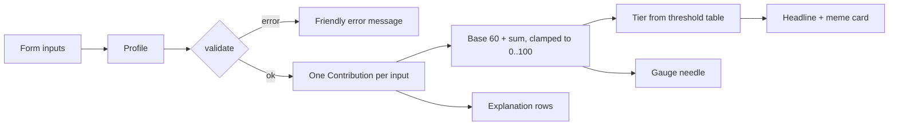

# is_hypergamy_real

> **For fun only. Not science, not advice.**

A joke side project with a slightly serious core: a literature review (and,
later, a short paper) on whether *hypergamy* (partnering with someone of higher
status, income or education) is a real, measurable pattern, plus a
deliberately silly desktop app, the **Hypergamy Meter**.

## The Hypergamy Meter

You enter a few facts (age, gender, education, income band, optional height,
country/region, relationship goal), press **Consult the market**, and the app
gives you a completely unscientific "market verdict":

- a red-to-green **meter** with a needle and a score from 0 to 100,
- a **headline tier**, from "Top of the market" all the way down to
  "Your life is over (statistically, for this joke model) ;)",
- a **meme card** for that tier, drawn by the app itself (big white captions
  with a black outline over a coloured background and an emoji; no meme
  images are embedded or downloaded),
- a short list of **which inputs moved the score**, each with a one-line joke.

The humour is aimed at the model and at the idea of a "dating market", never at
any group of people. Non-binary users get the midpoint of the two sets of
weights, because the joke model has no data and admits it.

### Run it

Requires a recent stable Rust toolchain (edition 2024).

```sh
cd app
cargo run --release
```

Checks:

```sh
cd app
cargo fmt --check
cargo clippy --all-targets -- -D warnings
cargo test
```

### Screenshot

_Screenshot coming soon._ <!-- TODO: add docs/screenshot.png -->

## Architecture

The app is one small crate in `app/` (`hypergamy_meter`, GUI with
[eframe/egui](https://github.com/emilk/egui) 0.37.0, pinned).

| File | What it does |
|------|--------------|
| `app/src/main.rs` | Opens the native window and hands it to `ui::MeterApp`. |
| `app/src/model.rs` | The scoring model. Input enums (`Gender`, `Education`, `IncomeBand`, `Region`, `Goal`), `Profile`, validation, one pure function per input that returns a signed `Contribution`, the clamped total, and the `Tier` table. All unit-tested. |
| `app/src/ui.rs` | The egui form and the verdict panel (headline, explanation rows, disclaimer footer). Holds the app state. |
| `app/src/gauge.rs` | Draws the semicircular meter with the egui painter. |
| `app/src/memes.rs` | The meme table (one card per tier: top text, bottom text, emoji, colour, joke line) and the code that draws a card. |

How a score flows:



1. The form fills a `Profile` (closed sets are enums, so there is nothing to
   parse; age and height are range-limited number fields).
2. `model::evaluate` validates the profile and returns a `Result`, so a bad
   value becomes an on-screen message, never a crash.
3. Each input adds or removes points from a base of 60. The weights are
   hand-picked and **illustrative, not estimates**; the comment block at the
   top of `model.rs` says which findings they loosely echo (modest stated sex
   differences in valuing earning prospects; educational hypergamy weakening
   or reversing, so a "marry up" market for highly educated women is modelled
   as tighter, more so where that norm is stronger; age curves peaking at
   different ages).
4. The score is clamped to 0..100 and mapped to a `Tier` by the
   `Tier::THRESHOLDS` table; the tier picks the headline and the meme card.

## Where the real stuff lives

- `literature_review.md`, `notes.md`, `bibliography.bib`: the literature
  review and annotated bibliography on hypergamy.
- `paper/`: the paper (coming later).

## License

MIT, see [LICENSE](LICENSE).
