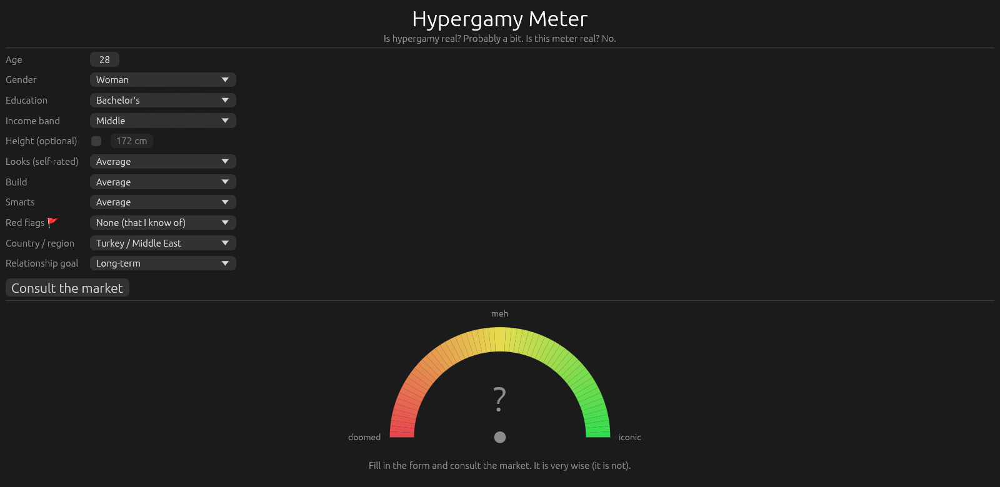
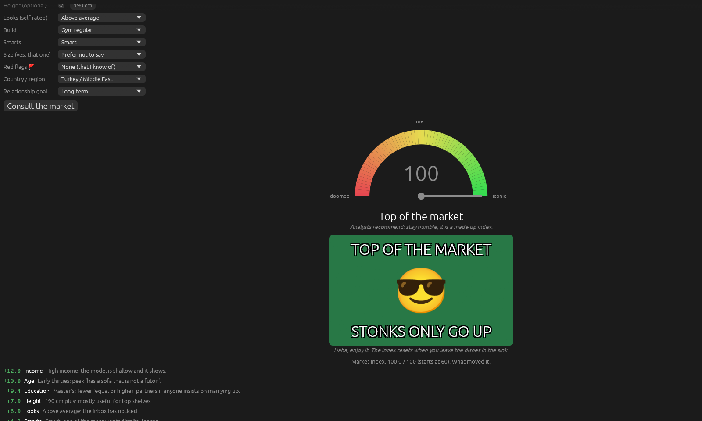
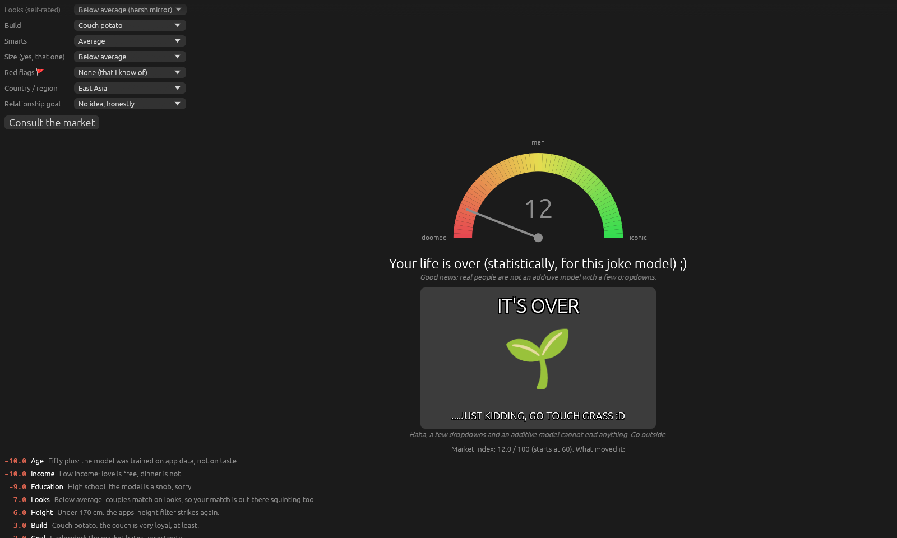
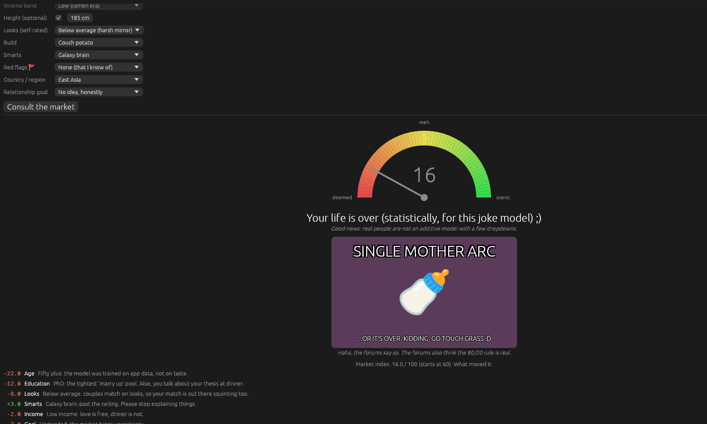

# is_hypergamy_real

> **For fun only. Not science, not advice.**

A joke side project with a slightly serious core: a literature review and a
short IEEE-style paper on whether *hypergamy* (partnering with someone of higher
status, income or education) is a real, measurable pattern, plus a
deliberately silly desktop app, the **Hypergamy Meter**.

## The Hypergamy Meter

You enter a few facts (age, gender, education, income band, optional height,
self-rated looks, build and smarts, red flags, an optional size joke for men,
country/region, relationship goal), press **Consult the market**, and the app
gives you a completely unscientific "market verdict":

- a red-to-green **meter** with a needle and a score from 0 to 100,
- a **headline tier**, from "Top of the market" all the way down to
  "Your life is over (statistically, for this joke model) ;)",
- a **meme card** for that tier, drawn by the app itself (big white captions
  with a black outline over a coloured background and an emoji; no meme
  images are embedded or downloaded),
- a short list of **which inputs moved the score**, each with a one-line joke.

The humour is aimed at the model and at the idea of a "dating market", never at
any group of people. Non-binary users get the midpoint of the two sets of
weights, because the joke model has no data and admits it. Ethnicity is
deliberately **not** an input: the studies on it document discrimination, and
scoring people by it would repeat that discrimination (see section 11.8 of the
review).

### Run it

Requires a recent stable Rust toolchain (edition 2024).

```sh
cd app
cargo run --release
```

To open the app already scored with a preset profile (handy for screenshots):

```sh
cargo run --release -- --demo top                # or niche, its-over, single-mother-arc
```

### Screenshots

The form before you press the button:



Top of the market (`--demo top`):



The bottom tier for men (`--demo its-over`) and for women (`--demo single-mother-arc`):




More demos: `--demo niche` (screenshot in `docs/screenshots/niche.png`).

## Where the real stuff lives

- `literature_review.md`, `notes.md`, `bibliography.bib`: the literature
  review and annotated bibliography on hypergamy.
- `paper/`: the paper (`paper/main.pdf`).

## License

MIT, see [LICENSE](LICENSE).
